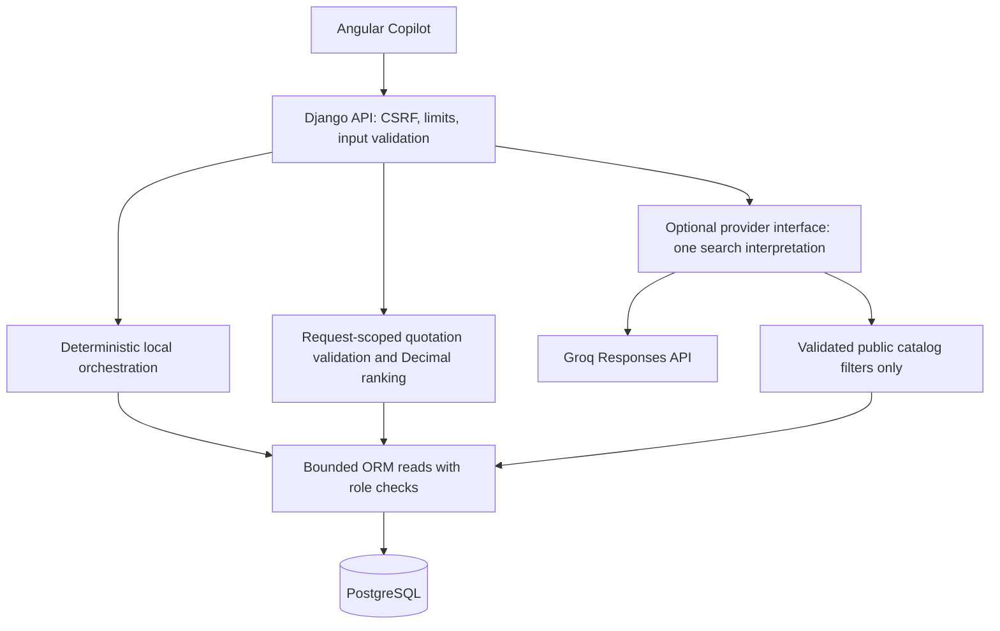

# Jedel Procurement Copilot: implementation and operation

The MVP adds `/ai-assistant` and read-only Django tools without database migrations. It is useful with no AI key: real catalog filtering, approved CSV quotation comparison, authorized inventory questions and review-only order proposals work locally. GroqCloud is the only cloud provider. English/Russian conversation and tool selection reuse the existing assistant. No model can approve, deliver, cancel, create orders or edit inventory.

## Audit and available evidence

Before editing, branch/status were checked on `feature/fullstack-integration-auth`; existing teammate changes were preserved. Reviewed Angular navigation/routes/session state, safe catalog projection, Django group capabilities and protected APIs, serializers, purchasing services, PostgreSQL unmanaged mappings, report definitions, environment loading/dependencies, tests, Bekarys business requirements and Yerbolat SQL role model. The six roles were already provisioned and verified in [LIVE_RBAC_PROVISIONING.md](LIVE_RBAC_PROVISIONING.md). This task does not change their memberships or permissions.

Existing working functionality includes session login/registration/logout, CSRF, role-aware public/business pages, catalog CRUD, atomic purchasing transitions and reports. Existing data is product ID/name/category/internal price/stock, supplier directory, purchase orders and captured line prices. Missing: supplier-product catalog relationships, current supplier quotations, product specifications, unit definitions, verified FX, payment data and sufficient demand history. No prices/offers, equivalence, demand forecasts or marketplace connections were invented to fill these gaps.

## Architecture and boundaries



Private local questions are handled before provider configuration/consent checks. Supported forms (case insensitive):

- `Which products have low stock?`
- `What items should we consider purchasing?`
- `Show low stock`
- `Show inventory levels for category Hardware.`
- `Prepare a purchase order for 20 units of product 1 from supplier 2.` (also accepts `Help me prepare ...` and optional `#` before IDs)
- `Show purchase order 1 status.`

Use actual IDs; these examples are syntax, not assertions that those records exist. Category inventory returns all matching stock levels, at most 20. Low-stock requests use the explicitly proposed threshold 20; structured inventory controls allow a different request threshold. There is no stored product reorder point or forecast. Unsupported private purchasing instructions are rejected locally and never forwarded to the provider. There is no general SQL, filesystem, URL fetch, marketplace scraper or arbitrary tool dispatcher.

Only the current explicitly consented user message is sent to Groq. One Responses request can return general prose or one validated function call: public catalog search, authorized inventory/status reads, review-only draft, or quotation-comparison guidance. Django executes the tool and renders results locally; no database rows, quotations, supplier contacts, prices or tool outputs are returned to the model. Existing structured CSV comparison still uses Decimal locally and requires source/equivalence confirmation. Quotation comparison through chat directs the user to this form instead of transmitting CSV.

General prose is labeled Groq conversation, not PostgreSQL facts. Model output is untrusted: all tool names and arguments are validated and every private tool rechecks the current user's permissions. There are no write tools, arbitrary SQL, built-in browser search, code execution, MCP, recursive loops or fallback providers.

[Groq Responses documentation](https://console.groq.com/docs/responses-api) lists `previous_response_id`, `store`, `truncation` and `include` as unsupported. None is sent. Only one current message is sent (zero prior turns); the bounded ten-message UI transcript is display-only and cleared on account change. No server-side chaining or tool-result follow-up request is used. Ask standalone questions with explicit IDs. This intentionally avoids leaking previously displayed private results through chat history.

[Groq's model page](https://console.groq.com/docs/model/openai/gpt-oss-20b) documents tool calling for `openai/gpt-oss-20b`. This is the only reviewed model accepted by the adapter. The pinned `openai==3.49.0` package is merely the compatible HTTP client; the fixed base URL is `https://api.groq.com/openai/v1`, so inference goes only to Groq. No OpenAI account/key is required. No live provider request has been made during this conversion.


## Role policy

| Role | Public search | Optional catalog AI* | Offers / inventory / order status | Review-only order draft |
|---|---|---|---|---|
| Anonymous | Yes | No | No | No |
| Basic User | Yes | Yes | No | No |
| Purchasing Employee | Yes | Yes | Yes | Yes |
| Purchasing Manager | Yes | Yes | Yes | Yes |
| Analyst / Tester | Yes | Yes | Yes | No |
| System Administrator | Yes | Yes | Yes | Yes |
| Security Administrator | Yes | Yes | No | No |

\* Requires explicit consent, enabled provider configuration and available request budget. Roles compose using the existing capability union; superusers are trusted separately. Angular uses server capabilities for controls, and each private tool independently checks permissions even outside a view. All product search cards, including privileged search results, contain only `product_id`, `product_name`, `category`. Inventory and proposals expose additional fields only through authorized local tools. Supplier options contain ID/name, never emails/phones/addresses.

## API

All paths are under `/api/ai/`. Session authentication is reused; every POST requires a CSRF cookie/header, including anonymous search. GET capabilities does not disclose records. Unsupported HTTP methods remain unavailable.

| Method / route | Inputs | Access |
|---|---|---|
| GET `capabilities/` | None | Public; permission-aware feature flags |
| POST `products/search/` | `query` (100 chars), `category` (50), `match` = partial/exact | Public; 20 results maximum |
| POST `chat/` | `message` (1000 chars), `consent_to_provider` | Authenticated; local private intents also require their tool capability |
| POST `inventory/` | `category`, `threshold` (default 20), `low_only` (default true) | Business read; 20 rows maximum |
| GET `suppliers/` | None | Order-preparation permission; first 50 directory choices |
| POST `orders/draft/` | `product_id`, `supplier_id`, `quantity` | Order-preparation permission; no persistence |
| POST `orders/status/` | `order_id` | Business read |
| POST `offers/compare/` | `product_id`, `quantity`, `csv`, `approved_source`, `equivalence_confirmed`, optional `max_delivery_days` | Business read |

Unknown input fields are rejected, not accepted as role/filter instructions. Quantities are positive whole numbers up to 1,000,000. Requests are limited to 96 KiB actual JSON bytes; CSV content is additionally limited to 64 KiB and 50 rows. Errors: 400 validation, 401 unauthenticated private tool, 403 role/CSRF/consent, 404 unknown record, 413 size, 429 rate, 503 provider/database unavailable. Errors do not echo credentials, quotation cells, raw provider exceptions or SQL details. Public detail lookup continues through the existing `/api/catalog/products/{id}/`.

## Approved quotation CSV

Upload UTF-8 CSV in the page. Use this exact header/order:

```csv
product_id,supplier_id,unit_price,currency,unit,available_quantity,min_order_quantity,delivery_cost,delivery_days,quoted_at,valid_until,source,reference,specifications
```

Each row is one current supplier quotation for the selected real product and existing supplier. No sample rows are loaded automatically. Monetary inputs are nonnegative finite Decimal values, maximum 99999999.99, with at most two decimal places. Availability is a nonnegative whole number; minimum order is positive; delivery time is an integer from 0 to 3650 days. `quoted_at` must be timezone-aware ISO8601, not in the future. `valid_until` may be blank (warning), otherwise must be at/after quotation time. Source/reference/specifications are required bounded single-line text. Spreadsheet formula prefixes, NULs, malformed field counts, duplicate supplier/reference pairs and oversized inputs are rejected. Untrusted text is displayed using Angular text bindings, not HTML; it is never interpreted as instructions or sent to the model.

The importing business reader must affirm that the source is approved and product/specification equivalence was checked. This is human attestation, not cryptographic supplier authentication or an administrator-maintained approved-source registry. There is no product-specification or offer relationship in the current database, so the system cannot independently establish equivalence or availability. Supplier/source fields and import timestamp remain visible for review.

Supported currencies: KZT, USD, EUR, GBP. A comparison must contain only one currency. Mixed currencies are rejected; no FX rate is fabricated. `unit`, `units`, `piece`, `pieces`, `pc`, `pcs` normalize to an individual `unit`. Packs, weights and other conversions are rejected rather than guessed. Price and delivery are assumed tax-inclusive; confirm this with the supplier. All quotations remain request-scoped; neither files nor quotes are persisted server-side.

Eligibility requires quoted availability >= requested quantity, quantity >= minimum, compliance with any delivery limit, a nonexpired validity end when supplied, and a quotation no older than 30 days. Ineligible rows remain visible with reasons but cannot win. Blank source information is rejected, while absent validity end produces a warning. No quotations means an explicit empty result, not generated offers.

Calculations use Python Decimal:

```text
subtotal = quantity * quoted_unit_price
total = subtotal + quoted_delivery_cost
effective_unit_cost = total / quantity
```

Costs are returned as two-decimal strings; effective unit cost is rounded half-up to four decimals. Eligible results rank by lowest total cost; delivery days break cost ties, followed by supplier ID/reference for deterministic ordering. Every row shows its calculation, delivery, availability, minimum, source, quote timestamp, validity, specification text and eligibility warnings. No reliability score or payment claim is inferred. Both best reference and supplier ID identify the chosen row.

## Order proposals

Proposals validate a real product, real supplier and quantity, and show the current internal catalog price in KZT with a Decimal subtotal. This price is not represented as a confirmed supplier quotation. Supplier-product availability, delivery and taxes remain unverified. A draft has `draft_only=true`, `persisted=false`; creating, approving, delivering and cancellation are impossible from these tools. The normal order form is linked for human review and existing service validation. No captured historical prices or stock fields are changed.

## Installation and configuration

Backend `.env` is loaded by the existing environment loader. Root `.env` supplies Compose configuration. The backend example keeps the secret empty and cloud requests disabled by default:

```dotenv
AI_ENABLED=false
AI_PROVIDER=groq
GROQ_API_KEY=
AI_MODEL=openai/gpt-oss-20b
AI_TIMEOUT_SECONDS=15
AI_MAX_OUTPUT_TOKENS=512
AI_DAILY_CALL_LIMIT=100
AI_USER_DAILY_CALL_LIMIT=20
AI_CHAT_REQUESTS_PER_MINUTE=5
```

To activate Groq, privately edit **backend/.env**: set `AI_ENABLED=true`, `AI_PROVIDER=groq`, `AI_MODEL=openai/gpt-oss-20b`, and paste your key only into `GROQ_API_KEY`. Restart Django. This task did not edit your private file or credentials. Existing shell environment variables take precedence over the file. Never put the key in Angular, screenshots, Git or chat.

Run `python manage.py copilot_status` in the activated backend virtual environment. It reports provider/model, key presence, enabled state and local tools without making network/database requests. Configuration readiness is not a successful connectivity test. The inspected local file loads correctly, but AI is disabled and the Groq key is missing. The compatible SDK exists in `.venv`; system Python may lack it.

Keep your Groq project/account on Free Tier; do not enable paid billing. The application cannot inspect or enforce your provider account's billing tier. It does not upgrade accounts or enable paid features and has no fallback. HTTP 429 returns an actionable limit message; invalid credentials, timeouts and outages return sanitized errors. Ordinary PostgreSQL/Decimal tools remain usable independently.

Safeguards: one inference attempt and at most one local tool per chat; no retries, 15-second default timeout (bounded 1-30), 512 output tokens (bounded 128-1024), input at most 1000 characters. Chat rate is configurable (default 5/min per user, max 20). General local Copilot requests retain 30/min per user or anonymous IP. Provider attempts, including failures, consume rolling 24-hour global/per-user budgets (100/20 default). The development LocMemCache resets on restart and is per process; multiworker deployment needs a shared atomic cache and edge throttling. These application ceilings do not prove a free provider billing tier.

Private tool results are not sent to the provider. Only the currently consented user message leaves Django; never type confidential data into external chat. Recognizable credentials, email addresses and mutation commands are rejected before transmission, but this is not comprehensive data-loss prevention. No prompt/key/tool-result logging is added. Provider retention policies are controlled by Groq; unsupported `store` is omitted, not set to false.

Optional smoke test, **only after separate explicit approval**:

```powershell
python manage.py copilot_smoke --confirm-external-request
```

It sends one harmless greeting with 64 output tokens, no database reads/data, no retries, and sanitized failure reporting. Without the flag it refuses to send anything. It was not executed with that flag during this task. No real Groq connectivity or live response quality has been verified.

Windows PowerShell (existing configured PostgreSQL required; do not migrate the live database):

```powershell
cd D:\BIS_project\jedel-group-database\backend
.venv\Scripts\python.exe -m pip install -r requirements.txt
.\.venv\Scripts\Activate.ps1
python manage.py runserver
```

Your existing activated/interpreter setup also continues to support `python manage.py runserver`.

In a second PowerShell:

```powershell
cd D:\BIS_project\jedel-group-database\frontend
npm.cmd ci
npm.cmd start
```

macOS bash/zsh, from the cloned repository:

```bash
cd backend
python3 -m venv .venv
source .venv/bin/activate
python -m pip install -r requirements.txt
python manage.py runserver
```

Second terminal: `cd frontend`, `npm ci`, `npm start`. Follow the existing development guide for first-time isolated PostgreSQL setup. Open `http://localhost:4200/ai-assistant`; requests use the existing Angular `/api` proxy. No shared bearer token is needed. macOS execution was not verified during this task.

Compose: configure root `.env`, then `docker compose up --build`. The existing Compose initializer is guarded for its separate `jedel_dev` database. This task adds optional AI environment forwarding, not a live database initializer. Docker execution/portability was not newly verified here.

## Tests and manual verification

Backend tests use `backend/scripts/test_postgres.py`, never the live database. The runner forcibly disables AI/clears provider credentials. Provider tests inject mock SDK results and exceptions; the installed SDK contract is checked without a network inference call.

```powershell
# From backend; PostgreSQL 17 binaries required
python scripts/test_postgres.py apps.purchasing.test_copilot
$env:JEDEL_BROWSER_TESTS='1'
$env:JEDEL_VERIFY_DEVELOPMENT='1'
python scripts/test_postgres.py
# From frontend
npm.cmd test -- --watch=false
npm.cmd run build
```

Install Playwright Chromium locally if absent with `npx playwright install chromium`; run browser tests through the isolated backend harness, not against real company data. macOS uses `npm` instead of `npm.cmd` and can set the flags with `JEDEL_BROWSER_TESTS=1 JEDEL_VERIFY_DEVELOPMENT=1 python scripts/test_postgres.py`. No live provider smoke test was authorized or performed.

Manual browser checks:

1. Logged out, open AI Assistant. Search a real product/category. Check public IDs/names/categories and honest empty states; no prices, stock or supplier contacts.
2. Basic User sees the same safe catalog and access guidance. AI catalog interpretation requires configuration and explicit consent. Protected inventory questions are denied by Django, without a login loop.
3. Employee/Manager/Admin can select a real product, enter quantity, upload actual approved quotations, confirm source/equivalence and compare totals. Try mixed currencies, expired quotes and unmet minimum quantities. Review source/calculations before any purchasing decision.
4. Analyst can read inventory/compare offers but cannot draft an order. Security Administrator cannot access purchasing tools. Role labels do not override server permissions.
5. Authorized staff can ask a supported inventory/order question without AI. Review a draft: verify the page says not saved, order count and stock unchanged. Use only isolated test data for any later normal purchasing operations.
6. Check unavailable backend/provider errors, retry controls and logout clearing. At 390px width, tables should scroll within their region and cards/controls remain accessible.

## Limitations and verification record

There is no live marketplace/Kaspi integration, FX feed, persistent quotation history, automatic specification matching, supplier-product relation, demand forecasting or provider conversation memory. Natural-language private intents use the documented narrow grammar; other private requests must use the structured forms. The optional Groq model supports general conversation and validated tool selection. Live Groq connectivity, free-tier account eligibility and answer quality remain unverified. No new migration or live database modification is required or performed.

Final test counts, exact file list and browser results are recorded in AI_COPILOT_VERIFICATION.md after execution.

For field-by-field manual tests, safe configuration diagnostics and a fictional quotation CSV, see [the beginner testing checklist](AI_COPILOT_TESTING.md).
