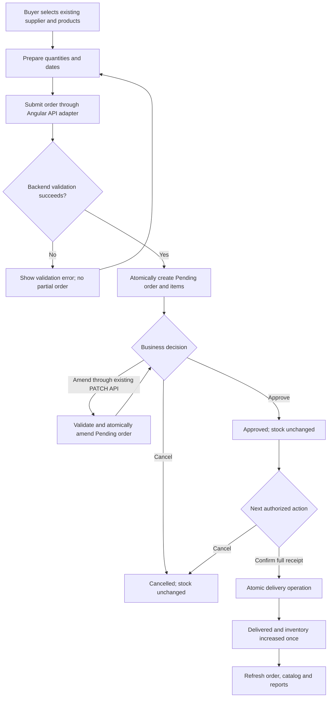
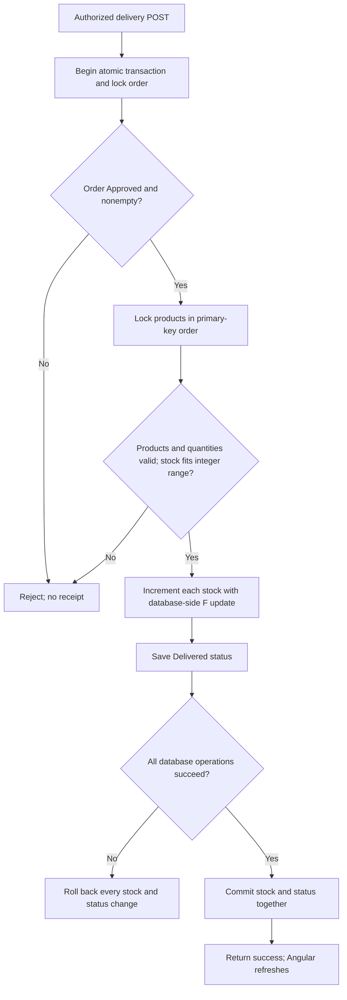
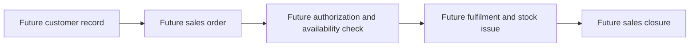

# Business processes

This is an analysis of existing behavior, not new implementation. Requirement identifiers are defined in [the specification](business-requirements.md); technical evidence is in [traceability](requirements-traceability.md).

## Supplier purchasing workflow

Participants are Buyer/Admin, Approver/Admin, the Angular application and the Django/PostgreSQL boundary. API roles are shared credentials, not individual accountable employees.



The amendment branch describes the implemented backend API, not an existing Angular edit form. On a failed amendment, existing order data remains unchanged. The delivery success branch is conditional on the detailed checks below. A transport failure can leave the caller uncertain even when a server transaction committed.

Supplier maintenance (FR-01/BR-13/BR-14) and product catalog maintenance (FR-02/BR-15) occur before order preparation when records are missing. Invalid supplier email/address or product price must be corrected before successful save. No customer or supplier portal is implied.

## Creation and approval

```mermaid
sequenceDiagram
    actor Buyer
    participant UI as Angular purchasing page
    participant API as Django order API
    participant DB as PostgreSQL
    actor Approver
    Buyer->>UI: Select supplier, product lines, quantities and dates
    UI->>API: POST /api/orders/
    API->>API: Validate input and allowed fields
    API->>DB: Atomic reference locks, parent and item creation
    alt Validation or transaction fails
        API-->>UI: Safe error; no partial order committed
    else Creation commits
        API-->>UI: 201 with Pending order and captured prices
        UI->>API: Refresh resources and reports
        Approver->>API: POST /api/orders/{id}/approve/
        API->>DB: Lock order; require Pending and nonempty items
        API-->>Approver: Confirm Approved or report conflict
    end
```

Approval does not reserve stock, receive goods, record a payment or create an approval-history record. Creation captures prices; frontend draft values are estimates until confirmed by the backend. Pending amendments are atomic and may explicitly revise purchase prices. Approved orders are not editable through the order PATCH operation.

## Delivery and inventory receipt



Any database failure during stock increments also goes to rollback, not only failure at the final save. A competing delivery waits for the order lock and then observes Delivered, so it is rejected without a second increment. Different orders lock shared products consistently and increment using F expressions. BR-08/BR-09/BR-11 apply. This is full receipt only; no individual line receipt quantities are accepted.

## Cancellation scenarios

| Situation | Responsible API role | Outcome |
| --- | --- | --- |
| Pending order no longer needed | Approver/Admin | Cancelled; no inventory movement |
| Approved order will not be received | Approver/Admin | Cancelled; no inventory movement |
| Receipt already committed | Any caller | Cancellation rejected; reversal is not implemented |
| Already Cancelled | Any caller | Repeated cancellation rejected |
| Delivery and cancellation race | Approver/Admin requests | Row lock serializes decisions; one terminal outcome wins |

Cancellation has no recorded reason, actor identity or timestamp beyond what already exists in the schema. Do not invent those fields. There is no rollback of previously delivered inventory through cancellation.

## Failure and recovery responsibilities

The operator corrects HTTP 400 input, obtains a suitable credential for 401/403, and refreshes after 404/409 conflicts. An unavailable service or ambiguous write response requires reading current state before retrying. Angular does not manufacture success, automatically retry writes or substitute demo data. A confirmed mutation followed by refresh failure is reported as confirmed-but-not-refreshed, not as permission to resubmit.

## FUTURE SCOPE — customer sales



This diagram is a conceptual proposal only. There are no customer/sales tables, APIs or acceptance claims here. Stock issue is not implemented by reversing the delivery service or permitting negative purchase quantities. Any schema-dependent sales proposal requires separate approval and a dedicated requirements exercise.
