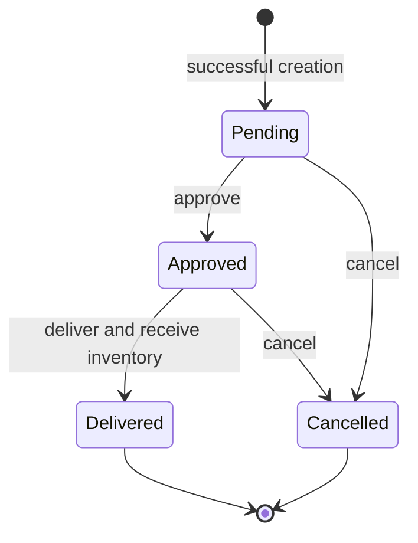

# Purchase order lifecycle

Source of current transition behavior: [services.py](../../backend/apps/purchasing/services.py), specifically `transition_order`. API adapters are `OrderViewSet.approve`, `deliver` and `cancel` in [views.py](../../backend/apps/purchasing/api/views.py). This document introduces no second transition implementation.

## State diagram

The final markers mean workflow completion, not deletion. A Pending amendment does not change state and is deliberately not drawn as an action that re-enters the lifecycle. No state is added to the existing four-value status CHECK.

## Transition matrix

| From / requested target | Pending | Approved | Delivered | Cancelled |
| --- | --- | --- | --- | --- |
| Pending | Invalid status transition | Valid approve | Invalid; approve first | Valid cancel |
| Approved | Invalid reopening | Invalid repeat | Valid full receipt | Valid cancel |
| Delivered | Invalid reopening | Invalid | Invalid repeat receipt | Invalid reversal |
| Cancelled | Invalid reopening | Invalid | Invalid receipt | Invalid repeat |

No dedicated action sets Pending. A PATCH to a Pending order is an amendment, not a status transition; direct status input is rejected. The matrix assumes an authenticated role authorized for the action. Authorization failure may reject a request before state evaluation.

## Preconditions, responsibilities and effects

| Operation | Role | Preconditions | Postconditions | Inventory |
| --- | --- | --- | --- | --- |
| Create | Buyer/Admin | Existing supplier; 1–500 unique valid product lines; quantities/prices/dates valid | Parent/items committed as Pending; captured prices returned | Unchanged |
| Amend | Buyer/Admin | Order Pending under lock; changed references/dates/items valid | Changes committed atomically; retained prices preserved unless explicitly revised | Unchanged |
| Approve | Approver/Admin | Order Pending under lock; items nonempty | Approved persisted | Unchanged |
| Deliver | Approver/Admin | Order Approved; nonempty lines; products locked in primary-key order; positive quantities; no integer overflow | Every increment and Delivered status commit together | Increase by each captured line quantity once |
| Cancel | Approver/Admin | Order Pending or Approved under lock | Cancelled persisted and terminal | Unchanged |

Approval is not a physical receipt. The same Approver credential can approve and receive; separation between named author and approver is not enforced. Admin is permitted all listed operations. Viewer cannot perform mutations; Buyer cannot transition; Approver cannot maintain catalogs. Exact capabilities originate in `ApiPrincipal.capabilities` and `ReadOrWriteAccess.has_permission`, not this table.

## Transaction and failure contract

`create_order`, `amend_order` and `transition_order` use `transaction.atomic()`. `transition_order` locks the order with `select_for_update()`. Delivery locks products consistently and applies guarded `F('stock_quantity') + quantity` updates; affected-row checks and overflow guards precede final status commit.

| Failure | Expected behavior | Evidence |
| --- | --- | --- |
| Invalid request values/references | 400; no partial order | `BusinessApiTests.test_all_invalid_order_data_is_rejected_without_partial_records` |
| Invalid transition/empty receipt/overflow | 409; inventory unchanged | `test_delivery_status_actions_and_duplicate_protection`, `test_stock_overflow_rejects_delivery_without_partial_updates` |
| Second product update fails | Entire receipt rolled back; API database failure sanitized | Amir T19; `test_delivery_rolls_back_when_second_database_update_fails` |
| Delivered status save fails | Earlier increments rolled back | `test_delivery_rolls_back_product_updates_if_status_save_fails` |
| Two delivery requests | One succeeds; one conflicts; one receipt only | Amir T20; `ConcurrentDeliveryTests.test_two_delivery_attempts_increment_inventory_once` |
| Cancellation races delivery | One terminal winner; no cancelled receipt | `test_cancel_racing_delivery_has_one_winner` |
| Response lost after commit | Caller outcome uncertain; refresh before retry | Angular API adapter error/write handling |

Test file locations and exact method names are indexed in [traceability](requirements-traceability.md). These references are inspected evidence, not freshly executed results from this documentation task.

## Boundaries

The database status CHECK restricts values, but does not itself enforce this state machine or automatically receive stock. Direct SQL writers can bypass the service. Existing Delivered records may already have manually processed stock; never reset/replay them as a demonstration. There is no partial delivery, cancellation reason, receipt ledger, reversal, return or individual approval audit in this lifecycle. Such changes are separate proposals and may require schema approval.
